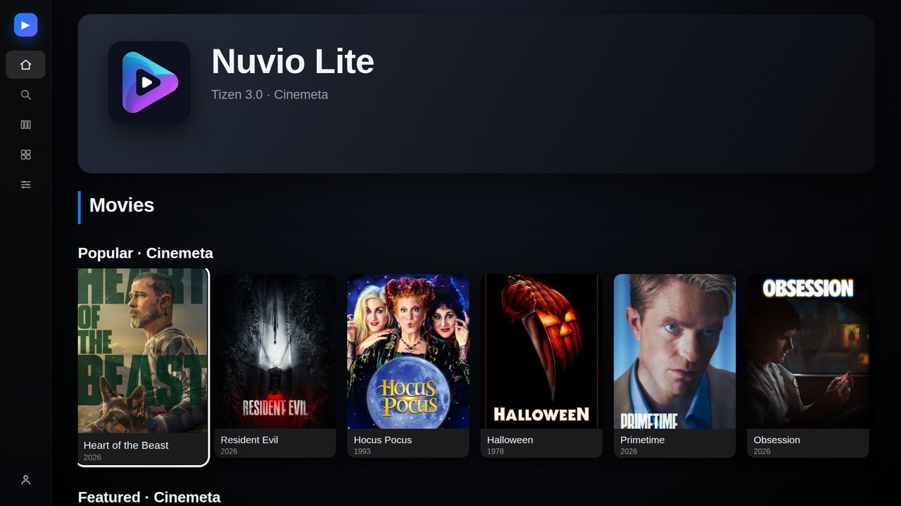
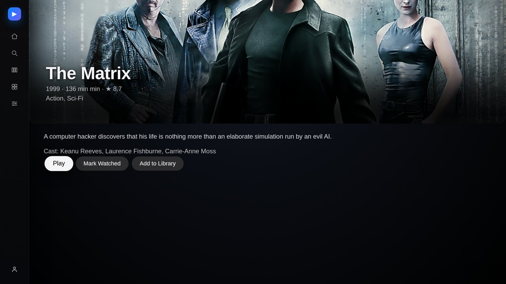
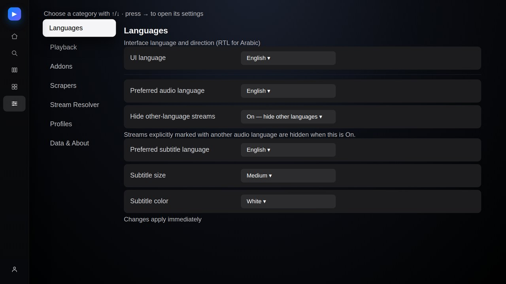
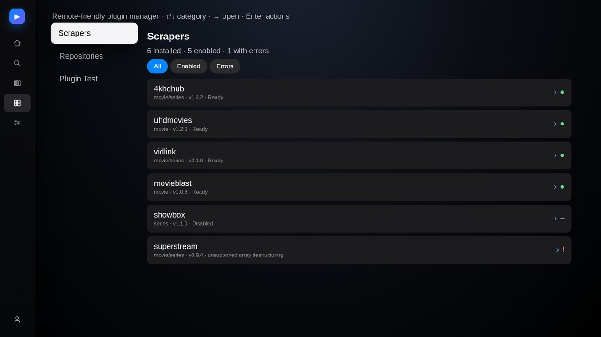
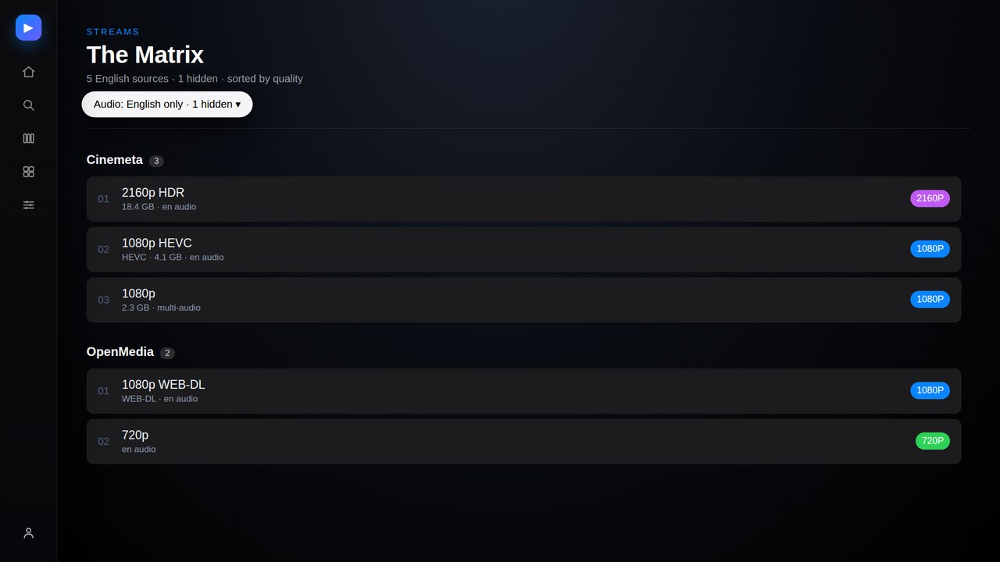

<div align="center">


# Nuvio Lite for Tizen 3.0

**An unofficial Nuvio client for 2017 Samsung TVs — Tizen 3.0 / Chromium 47.**

Vanilla ES5, no framework, no bundler at runtime, under 500 KB packaged.

[](#compatibility)
[](#why-es5)
[](#why-es5)
[](https://github.com/gbman54/nuvio-tizen3/actions/workflows/ci.yml)
[](LICENSE)

</div>

> **Not affiliated with NuvioMedia.** This is a community project. "Nuvio" is used only to describe compatibility with the Nuvio ecosystem. The official Nuvio apps are at [github.com/NuvioMedia](https://github.com/NuvioMedia).

---

## Why this exists

The official [NuvioTVSmart](https://github.com/NuvioMedia/NuvioTVSmart) targets **Tizen 4.0+ (Chromium 56)**. Samsung's 2017 UHD lineup — including the **UA55MU7000** this was built and tested on — ships **Tizen 3.0 with Chromium 47**, which is missing most modern JavaScript and CSS features the official app relies on.

Nuvio Lite is a from-scratch client for that hardware:

- **ES5 only.** No arrow functions, `const`/`let`, `async`, `Promise` syntax, spread, or classes in app code.
- **No `fetch`, no `grid`, no `gap`, no `aspect-ratio`.** XHR, inline-block and float layout throughout.
- **Runs in ~1 GB RAM** with a single spatial focus manager and no virtual DOM.
- **No torrent engine on the TV.** Direct HTTP/HTTPS/HLS sources, or magnets resolved by a LAN companion (Stremio server / TorrServer).

## Features

- **Apple TV–style UI** — dark translucent surfaces, rounded poster cards, white focus pill, left icon rail.
- **Stremio addons** — add any `manifest.json`, browse catalogs, search, metadata, streams. Cinemeta seeded by default.
- **On-device scrapers** — install community Nuvio provider repos, run them in a sandbox on the TV, no server required.
- **Playback** — AVPlay primary with an HTML5 fallback, seek/pause/resume, Next Episode, 10-second resume checkpoints.
- **Audio tracks** — pick a track, with a preferred-language filter that hides streams explicitly labelled in other languages (MULTI/dual-audio always allowed, toggle per title).
- **Subtitles** — embedded tracks plus app-rendered external subtitles (VTT downloaded once, converted on device, drawn above the AVPlay video plane, stays in sync while seeking).
- **5 UI languages** — English, العربية (full RTL), Français, Español, Türkçe.
- **Profiles** — 4 independent profiles with their own library, history and settings.
- **Optional Trakt** device-code sync.

## Screenshots

| Home | Detail | Settings |
|---|---|---|
|  |  |  |

| Plugins | Streams |
|---|---|
|  |  |

## Compatibility

| | |
|---|---|
| **Tested device** | Samsung UA55MU7000 (2017), Tizen 3.0, Chromium 47 |
| **Target** | Samsung Tizen 3.0 (2017) and newer |
| **Resolution** | 1920×1080 UI, scaled for 1280×720 panels |
| **Input** | D-pad remote only; platform IME is never used |
| **Package size** | ~315 KB source, limit 500 KB |

Other 2017 models on the same Tizen 3.0 firmware should work. Tizen 2.3/2.4 (2015–2016) is **not** supported — the app needs `webapis.avplay` and modern-enough DOM primitives.

## Install with the Tizen CLI

Everything is done from a terminal over the network — no USB stick and no Tizen Studio IDE. Commands are Linux/macOS; on Windows use the `.exe` installer, the same `tizen`/`sdb` commands, and replace `$HOME` with `%USERPROFILE%`.

**What you need**

| | Link |
|---|---|
| Tizen Studio / Tizen SDK 10.0 | [Download page](https://samsungtizenos.com/tools-download/) |
| Node.js ≥ 14 | [nodejs.org](https://nodejs.org/en/download) |
| Git | [git-scm.com](https://git-scm.com/downloads) |
| TV developer mode | [TV Device — Samsung Developer](https://developer.samsung.com/smarttv/develop/getting-started/using-sdk/tv-device.html) |

### 1. Enable Developer Mode on the TV

On the TV:

1. **Settings → General → System Manager → Other Settings → Developer Mode = ON**
2. Set **Host PC IP** to this computer's LAN address (`hostname -I` on Linux, `ipconfig` on Windows).
3. **Reboot the TV** (developer mode does not activate until it restarts).

Confirm the TV is listening:

```bash
curl http://<TV_IP>:8001/api/v2/
```

The JSON must contain `"developerMode":"1"` and your PC's IP in `developerIP`.

### 2. Install the Tizen Studio CLI

Download the **web CLI installer** for your OS:

| OS | Direct download |
|---|---|
| Linux | [`web-cli_Tizen_SDK_10.0_ubuntu-64.bin`](https://download.tizen.org/sdk/Installer/tizen-sdk_10.0/web-cli_Tizen_SDK_10.0_ubuntu-64.bin) |
| macOS | [`web-cli_Tizen_SDK_10.0_macos-64.bin`](https://download.tizen.org/sdk/Installer/tizen-sdk_10.0/web-cli_Tizen_SDK_10.0_macos-64.bin) |
| Windows | [`web-cli_Tizen_SDK_10.0_windows-64.exe`](https://download.tizen.org/sdk/Installer/tizen-sdk_10.0/web-cli_Tizen_SDK_10.0_windows-64.exe) |

Linux/macOS (use the matching filename on macOS):

```bash
chmod +x web-cli_Tizen_SDK_10.0_ubuntu-64.bin
./web-cli_Tizen_SDK_10.0_ubuntu-64.bin
```

Accept the licence and keep the default install path (`$HOME/tizen-studio`). If you prefer a fully offline installer, use `Baseline_Tizen_SDK_10.0_ubuntu-64.bin` from the same [directory](https://download.tizen.org/sdk/Installer/tizen-sdk_10.0/).

Add the CLI tools to your `PATH` (put this line in `~/.bashrc` or `~/.zshrc` to keep it):

```bash
export PATH="$HOME/tizen-studio/tools/ide/bin:$HOME/tizen-studio/tools:$PATH"
```

Check both tools are visible:

```bash
tizen version     # e.g. Tizen CLI 2.5.25
sdb version       # e.g. Smart Development Bridge version 4.2.36
```

Reference: [CLI commands](https://samsungtizenos.com/docs/sdk-tools/dotnet/vscode/baseline-sdk/common-tools/command-line-interface) and [SDB](https://samsungtizenos.com/docs/sdk-tools/dotnet/vscode/baseline-sdk/common-tools/smart-development-bridge).

### 3. Connect to the TV

```bash
sdb connect <TV_IP>:26101
sdb devices
```

You should see:

```
List of devices attached
192.168.1.50:26101     device          UA55MU7000
```

If `sdb devices` is empty:

```bash
sdb kill-server
sdb start-server
sdb connect <TV_IP>:26101
sdb connect <TV_IP>:26101      # the first attempt after a TV reboot often fails
```

### 4. Create a signing profile

Tizen widgets must be signed. On 2017 retail firmware a Samsung author/distributor chain is rejected at install (`install failed[118]`, stalls around `installing[22]`) even for a 5 KB test app. Sign with the **public distributor** that ships with Tizen Studio instead.

```bash
# The author alias MUST be exactly 10 characters on Tizen 3.0.
# Shorter app-id prefixes are rejected by the TV.
export AUTHOR_ID=nuvio12345
export NUVIO_CERT_PASS='choose-a-local-password'

# 1) Author certificate (stored in ~/tizen-studio-data/keystore/author/)
#    Skip this command if "$HOME/tizen-studio-data/keystore/author/$AUTHOR_ID.p12" already exists.
tizen certificate \
  -a "$AUTHOR_ID" -p "$NUVIO_CERT_PASS" \
  -c US -s California -ct "Los Angeles" \
  -o Nuvio -u Dev -n "Nuvio Lite" \
  -e dev@example.com -f "$AUTHOR_ID"

# 2) Signing profile using the SDK's public distributor
SDK="$HOME/tizen-studio/tools/certificate-generator/certificates/distributor/sdk-public"

tizen security-profiles add \
  -n NuvioTV -A \
  -a "$HOME/tizen-studio-data/keystore/author/$AUTHOR_ID.p12" -p "$NUVIO_CERT_PASS" \
  -c "$SDK/tizen-distributor-ca.cer" \
  -d "$SDK/tizen-distributor-signer.p12" \
  -dp tizenpkcs12passfordsigner
```

Verify the profile exists and is active:

```bash
tizen security-profiles list
```

Reference: [Working with the certificate profile](https://samsungtizenos.com/docs/sdk-tools/dotnet/vscode/baseline-sdk/common-tools/certificate-registration).

> The password only protects a local development certificate. Do not reuse a real password, and never commit `~/tizen-studio-data/keystore/` or `certs/`.

### 5. Clone and verify the source

```bash
git clone https://github.com/gbman54/nuvio-tizen3.git
cd nuvio-tizen3
npm run check-es5     # ES5 gate — must pass before anything is packaged
npm test              # unit tests
npm run build         # required files + version parity + size report
```

### 6. Package the WGT

Only these files belong inside the widget. `build-out/` is git-ignored.

```bash
rm -rf build-out
mkdir -p build-out
cp index.html config.xml icon.png icon_launcher.png build-out/
cp -r src assets build-out/

tizen package -t wgt -s NuvioTV -- build-out
```

Expected output:

```
Package File Location: /path/to/nuvio-tizen3/build-out/Nuvio Lite.wgt
```

> Bump the version in **both** `config.xml` and the About string in `src/js/09-views.js` for every reinstall — `npm run build` fails if they disagree, and the TV caches the widget by version.

### 7. Install and launch

Retail TVs disable the normal install commands. Push the WGT to the TV's shared folder, then install it with the whitelisted `vd_appinstall` command:

```bash
WGT="$PWD/build-out/Nuvio Lite.wgt"
REMOTE=/home/owner/share/tmp/sdk_tools/tmp/nuvio.wgt

sdb -s <TV_IP>:26101 push "$WGT" "$REMOTE"
sdb -s <TV_IP>:26101 shell 0 vd_appinstall nuvio12345.nuviolite "$REMOTE"
tizen run -p nuvio12345.nuviolite -s <TV_IP>:26101
```

The app appears in the TV's Apps list as **Nuvio Lite**.

If you downloaded a prebuilt release instead of building, skip steps 4–6 and run the same four commands with the downloaded `.wgt`.

### 8. Update, uninstall, inspect

```bash
# Reinstall a new build (bump config.xml + About first)
sdb -s <TV_IP>:26101 push "$WGT" "$REMOTE"
sdb -s <TV_IP>:26101 shell 0 vd_appinstall nuvio12345.nuviolite "$REMOTE"
tizen run -p nuvio12345.nuviolite -s <TV_IP>:26101

# Installed apps
sdb -s <TV_IP>:26101 shell 0 applist

# Uninstall
sdb -s <TV_IP>:26101 shell 0 vd_appuninstall nuvio12345.nuviolite

# Device id (useful when reporting install problems)
sdb -s <TV_IP>:26101 shell 0 getduid
```

`tizen run` prints `Tizen application is successfully launched.` when it worked. To read the JS console, use Tizen Studio's **Log View**, or on firmware that allows it:

```bash
sdb -s <TV_IP>:26101 shell 0 dlogutil | grep -i nuvio
```

### One-command helpers

If you already have a certificate profile, these wrap the steps above:

```bash
# Build → package → install → launch
NUVIO_CERT_PASS='choose-a-local-password' \
  node scripts/setup-tv.js --ip=<TV_IP> --profile=NuvioTV

# Install an existing (for example, downloaded) WGT
node scripts/install-tv.js --ip=<TV_IP> --wgt="Nuvio Lite.wgt"
```

## First run

1. **Addons** — Settings → Addons. Cinemeta is seeded; add any Stremio addon manifest URL.
2. **Scrapers** — Plugins → add a provider repo manifest. Known-working:
   ```
   https://raw.githubusercontent.com/yoruix/nuvio-providers/refs/heads/main/manifest.json
   https://raw.githubusercontent.com/phisher98/nuvio-providers/refs/heads/main/manifest.json
   ```
3. **Subtitles** — add an OpenSubtitles-style Stremio addon in Settings → Addons.
4. **Languages** — Settings → Languages: preferred audio and subtitle languages, plus "hide other audio languages" for the stream list.

## Project layout

```
index.html                Script tags in load order; stage + OSD roots
config.xml                Tizen widget manifest, privileges, CSP
src/css/app.css           Layout + tvOS theme layer (later rules override)
src/js/00-polyfill.js     Promise/Array/Object/String polyfills for M47
src/js/01-util.js         DOM helpers, stream-language parsing, VTT→SRT
src/js/02-storage.js      localStorage schema v1, per-profile settings
src/js/03-i18n.js         EN/AR/FR/ES/TR strings, RTL switch
src/js/04-http.js         XHR + timeout + one retry
src/js/05-api.js          Stremio client (manifest/catalog/meta/stream/subtitles)
src/js/06-resolver.js     Debrid vs LAN adapters
src/js/07-focus.js        Single spatial D-pad focus manager
src/js/08-keyboard.js     On-screen QWERTY + Arabic keyboard, symbols page
src/js/09-views.js        Home/Detail/Search/Library/Settings/Streams/Plugins UI
src/js/10-player.js       AVPlay + HTML5, OSD, tracks, app-rendered subtitles
src/js/11-trakt.js        Optional Trakt device-code sync
src/js/12-app.js          Key handling, stage scaling, Tizen keys, bootstrap
src/js/13-plugins.js      Scraper runtime: sandbox, transform, shims, repo manager
scripts/                  check-es5, build, package, install-tv, setup-tv
docs/                     Screenshots and notes
```

## Why ES5

The TV's Chromium 47 predates most of ES2015. `scripts/check-es5.js` parses every app file and rejects forbidden syntax before packaging, so a modern-looking edit can never ship and white-screen the TV. Runtime constraints this project respects:

| Constraint | Why |
|---|---|
| No `fetch`, `Promise` syntax, `async/await` | Not in Chromium 47 |
| No CSS `grid`, `gap`, `aspect-ratio` | Not supported / buggy |
| No Web Workers, WebAssembly, `tizen.filesystem` for web widgets | Unavailable to plain Tizen 3.0 widgets |
| AVPlay, not `<video>` | Hardware decoding; HTML5 is only a fallback |
| XHR + localStorage | Only reliable storage/network primitives |

## How the hard parts work

**Focus manager.** One spatial manager owns D-pad movement. It never calls `element.focus()`, because Tizen's native focus scroll runs after the app's scroll code and snapped the page to the top of a poster row. Scrolling is row-aware (whole row, 22 px gap above the title) and converts screen pixels to layout pixels using the stage scale.

**AVPlay.** `webapis.avplay` is a singleton, not a constructor. Audio tracks must be applied in `PLAYING` state using `AVPlayStreamInfo.index`, then verified with `getCurrentStreamInfo()` with staged fallbacks. AVPlay draws on a video plane *below* the web layer, so during playback `html`, `body` and `#stage` are made transparent, `#app` is hidden, and `PLAYER_DISPLAY_MODE_FULL_SCREEN` is set.

**External subtitles.** AVPlay's external-subtitle path never worked on this firmware. Instead the app downloads the VTT once, converts it to SRT, parses cues, and draws them in a web overlay above the video plane — so they work over AVPlay, follow seeks, and never reload the stream.

**Scraper sandbox.** Provider code runs in `new Function` with only `fetch` (XHR-backed), `console`, timers, `atob`/`btoa`, `Buffer`/`TextDecoder`/`URLSearchParams`, a DOMParser-backed mini `cheerio`, and a `crypto-js` shim (MD5, SHA-256, HMAC, AES-CBC). Runs are serialized, capped at 8 seconds, and a failing provider can never crash the app. ES2015+ syntax is transformed to ES5 on first run and cached; unsupported syntax fails with an explicit message.

## Known limitations

- No torrent/P2P on the TV. Direct URLs only, unless you run a LAN resolver.
- No WebAssembly, no Workers, no Node plugins, no platform IME.
- AVPlay subtitle size/colour settings are best-effort; app-rendered subtitles honour them fully.
- Cloudflare / JS-challenge hosts cannot be scraped.
- Some streams need `Referer`/`User-Agent`; AVPlay can receive them, HTML5 cannot.
- Trakt requires your own client ID.
- No content, addons, credentials, or signing keys are bundled.

## Troubleshooting

| Symptom | Cause / fix |
|---|---|
| `tizen: command not found` | Add the CLI to `PATH`: `export PATH="$HOME/tizen-studio/tools/ide/bin:$HOME/tizen-studio/tools:$PATH"` |
| `sdb devices` is empty | Developer Mode is off, the TV was not rebooted, or the Host PC IP is wrong. Check `curl http://<TV_IP>:8001/api/v2/`, then `sdb kill-server && sdb start-server` and `sdb connect` again |
| `sdb: serial number wrong` | `sdb kill-server && sdb start-server`, then connect two or three times |
| `sdb shell` prints `closed` | Expected on retail firmware; only `shell 0 <whitelisted-command>` works |
| `install failed[118]` | Stops at 22% when the certificate chain is rejected — sign with the public distributor profile (step 4) |
| `install failed[-1]` / already installed | Uninstall first, or bump the version in `config.xml` and `src/js/09-views.js` |
| `tizen package` says the profile is missing | `tizen security-profiles list`, then pass the exact name with `-s` |
| App launches an old build | The version was not bumped; the TV caches widgets by version. Bump both version strings and reinstall |
| `tizen run` fails but the app is listed | `sdb shell 0 applist` to confirm the app id, then launch it from the TV's Apps screen |
| Black screen on launch | ES5 gate should prevent this; read the console with Tizen Studio **Log View** or `sdb shell 0 dlogutil` |
| Launcher icon is still a blue tile | Reboot the TV once; Tizen caches launcher icons aggressively |
| Provider fails | Plugins → Plugin Test with a numeric TMDB ID; it shows the exact error and timing |

## Contributing

Bug reports and focused fixes are welcome. Please read [CONTRIBUTING.md](CONTRIBUTING.md) first.

The short version: open an issue with the TV model, Tizen version, app version and reproduction steps. Keep PRs small, run `npm run check-es5 && npm test`, and never commit certificates, keys, tokens or personal IP addresses.

## Security

See [SECURITY.md](SECURITY.md). Do not open public issues for security problems.

## License

[GNU General Public License v3.0](LICENSE).

This project is an independent community client. It is not affiliated with, endorsed by, or supported by NuvioMedia. Nuvio and related marks belong to their respective owners. No media content is provided or hosted by this project.
